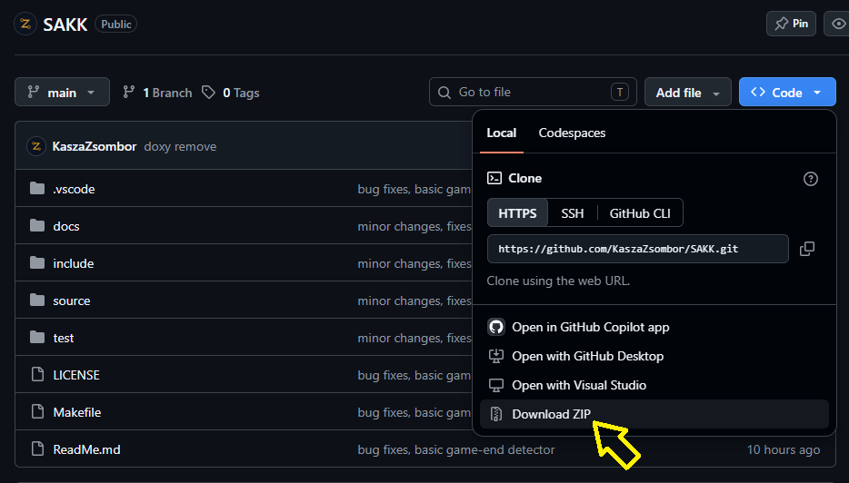
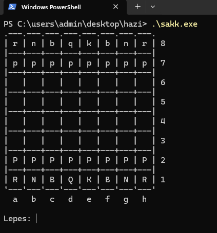

# Sakk program

## 2026/27 őszi félév, sakk program dokumentáció

Ez a dokumentum a Sakk program telepítését, használatát és főbb funkcióit ismerteti.

A dokumentáció célja, hogy a felhasználók megismerjék a program működését, a rendelkezésre álló lehetőségeket és a használat lépéseit.

---

## Telepítési útmutató

### Környezet ellenőrzése

Szükséges:

**gcc ellenőrzése:**

```bash
gcc --version
```

Ajánlott:

**git ellenőrzése:**

```bash
git --version
```

**make ellenőrzése:**

```bash
make --version
```

### 1. A projekt letöltése

Make és git használatával:

```bash
git clone https://github.com/KaszaZsombor/SAKK.git
```

Lépjen be a letöltött projekt könyvtárába:

```bash
cd SAKK
```

Futtassa az alábbi parancsot:

```bash
make
```

Ha nincs make és git telepítve:




Nyissa meg a terminált, majd lépjen be a telepítési könyvtárba:

```bash
gcc -Iinclude -std=c99 -c source/board.c -o bin/board.o
gcc -Iinclude -std=c99 -c source/main.c -o bin/main.o
gcc -Iinclude -std=c99 -c source/move.c -o bin/move.o
gcc -Iinclude -std=c99 -c source/movegenerator.c -o bin/movegenerator.o
gcc -Iinclude -std=c99 -c source/ui.c -o bin/ui.o
gcc  bin/board.o  bin/main.o  bin/move.o  bin/movegenerator.o  bin/ui.o -o sakk.exe
```

### 2. A program indítása

Lépjen be a telepítési mappába.

**Indítási parancs:**

```bash
sakk.exe
```

A futó program:



---

## Funkciók

### 1. Sakktábla megjelenítése

A program megjeleníti a sakktáblát és a sakkbábukat.

A felhasználó a táblán követheti az aktuális játékállást, és kiválaszthatja a mozgatni kívánt bábut.

### Lépések megadása

A lépéseket a következő formátumok egyikében kell megadni:

- **Normál lépés:** `e2e4` – az `e2` mezőről az `e4` mezőre történő lépés.
- **Gyalog átváltoztatása:** `f7f8Q` – a gyalog az `f7` mezőről az `f8` mezőre lép, majd vezérré változik.

A megadott formátum felépítése:
    - Az első két karakter a kiinduló mezőt jelöli.
    - A következő két karakter a célmezőt jelöli.
    - Átváltoztatás esetén az utolsó karakter a választott bábu jele, például `Q` (vezér).
    - Ha átváltozás esetén nincs megadva bábu, automatikusan vezérré alakul.

**Példák:**
    - `e2e4` – lépés az e2 mezőről az e4 mezőre.
    - `g1f3` – lépés a g1 mezőről az f3 mezőre.
    - `f7f8Q` – gyaloglépés vezérré változtatással.

### 3. Szabályos sakk-lépések ellenőrzése

A program a sakk szabályai alapján ellenőrzi a lehetséges lépéseket.

### 4. További funkciók

A további megvalósított funkciók itt sorolhatók fel, például:

- Sakk és sakk-matt felismerése.
- Patthelyzet felismerése.
- Gyalogátváltozás kezelése.
- Lépések és játékállások megjelenítése.

---

## Linkek

### Projekt elérhetősége

[A projekt GitHub-oldala itt elérhető](https://github.com/KaszaZsombor/SAKK)

### A dokumentáció

[A projekt dokumentációja itt elérhető](https://docs.kaszazsombor.hu)
